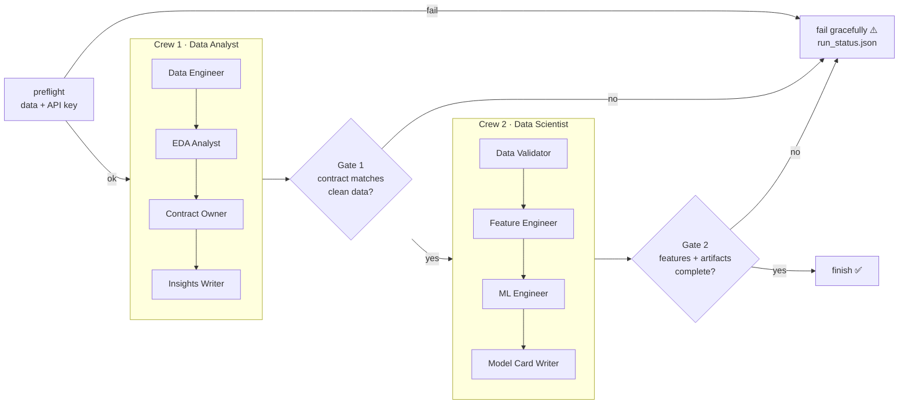

# Customer Churn Crew — Industry-Simulated AI Product Workflow

A **CrewAI Flow** that coordinates two multi-agent teams to turn raw telecom customer data
into a churn-risk list a retention manager can act on.

| | Question | Crew |
|---|---|---|
| 1 | *What has happened in the business?* | **Data Analyst Crew** (4 agents) |
| 2 | *What is likely to happen next?* | **Data Scientist Crew** (4 agents) |

**User:** a retention manager. **Screen:** one dashboard listing customers by churn risk,
each with a short explanation of *why*.

Dataset: [Telco Customer Churn (Kaggle)](https://www.kaggle.com/datasets/blastchar/telco-customer-churn) — 7,043 customers, 21 columns.

---

## Architecture



**Design principle:** agents never compute numbers. Every number comes from a deterministic
Python tool (pandas / scikit-learn) that the agent calls. The LLM writes only the narrative
documents (`insights.md`, `model_card.md`). This keeps the pipeline reproducible and stops the
agents from inventing numbers.

## Artifacts (saved in the repo)

| Crew | File | Content |
|---|---|---|
| Analyst | `artifacts/analyst/clean_data.csv` | Cleaned dataset |
| Analyst | `artifacts/analyst/eda_report.html` | EDA with KPIs and charts |
| Analyst | `artifacts/analyst/insights.md` | Business findings and recommendations |
| Analyst | `artifacts/analyst/dataset_contract.json` | Schema, allowed values, assumptions, constraints |
| Scientist | `artifacts/scientist/features.csv` | Model-ready features (5 engineered) |
| Scientist | `artifacts/scientist/model.joblib` | Selected model + explainer |
| Scientist | `artifacts/scientist/evaluation_report.md` | Baseline vs Logistic Regression vs Random Forest |
| Scientist | `artifacts/scientist/model_card.md` | Purpose, data, metrics, limitations, ethics |
| Scientist | `artifacts/scientist/scored_customers.csv` | Risk score + reasons per customer (feeds the app) |
| Flow | `artifacts/run_status.json` | Success or failure, stage, errors |

## Validation and failure handling

- **Gate 1 (handoff):** every Crew 1 artifact exists, and `clean_data.csv` matches
  `dataset_contract.json` (columns, types, nulls, allowed values, ranges, unique key, target).
- **Gate 2 (model):** all required features exist, are numeric and complete, and every Crew 2 artifact was saved.
- If a gate fails, the Flow skips the remaining steps, logs every violation and writes
  `run_status.json`. It never crashes.
- Demo: `python main.py --simulate-bad-data` drops a column and injects an invalid value, so
  Gate 1 stops the Flow before modeling.

## Reproducibility

- Fixed seed (`42`) for the split and the models; stable row ordering.
- LLM `temperature=0` with a fixed seed.
- Logs: `logs/pipeline.log`.
- `tests/` checks the Flow routing, graceful failure and identical metrics across runs. The tests run without an API key.

## Results (held-out test set, 1,409 customers)

| Model | ROC-AUC | Recall | Accuracy |
|---|---|---|---|
| Baseline (always "no churn") | 0.500 | 0.00 | 0.735 |
| Logistic Regression | 0.843 | 0.79 | 0.741 |
| **Random Forest (selected)** | **0.846** | **0.77** | **0.759** |

Calling the riskiest 10% of customers reaches ~29% of all churners, 2.9× better than random.

---

## Run it

```bash
python -m venv .venv
source .venv/bin/activate          # Windows: .venv\Scripts\activate
pip install -r requirements.txt
cp .env.example .env               # then add a free Gemini key (or an OpenAI key)

python main.py                     # full multi-agent CrewAI Flow
streamlit run app/streamlit_app.py # dashboard at http://localhost:8501
```

Other commands:

```bash
python run_pipeline.py             # same pipeline without LLM agents (no key needed)
python main.py --simulate-bad-data # demo of the validation gate
python -m pytest -q                # offline tests
```

## Project structure

```
├── main.py                 # runs the CrewAI Flow
├── run_pipeline.py         # deterministic pipeline, no LLM
├── app/streamlit_app.py    # one-screen dashboard
├── src/churn/
│   ├── flow.py             # Flow + gates + graceful failure
│   ├── crews/              # analyst_crew.py, scientist_crew.py
│   ├── tools/              # CrewAI tools wrapping the core functions
│   ├── analyst_core.py     # cleaning, EDA, contract
│   ├── scientist_core.py   # features, training, evaluation, explanations
│   ├── validation.py       # contract + feature checks
│   └── config.py
├── data/raw/telco_churn.csv
├── artifacts/              # all outputs
└── tests/
```
